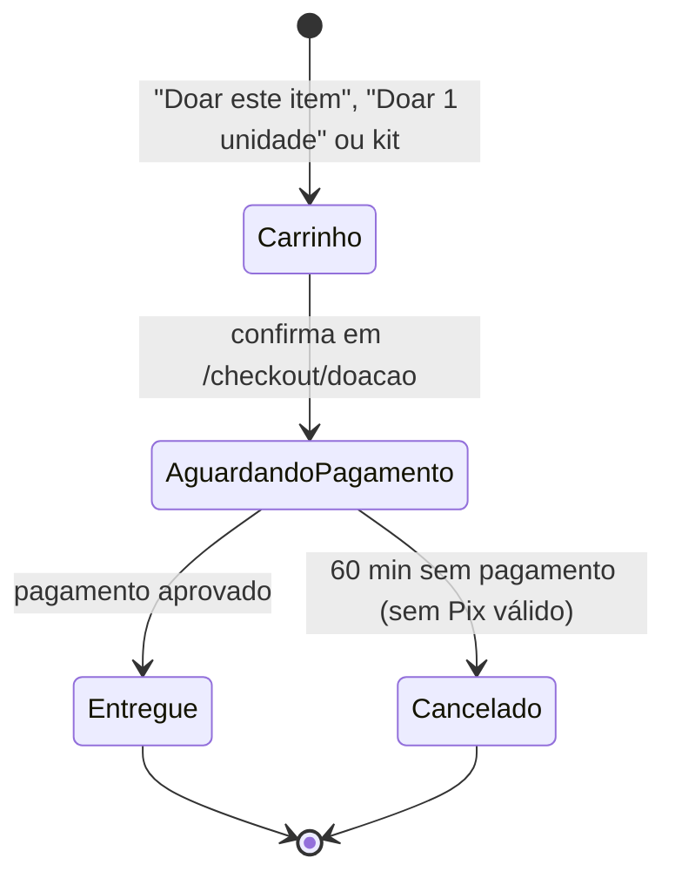

# Regras da compra para o abrigo

Documento da KAN-12. Descreve como funciona hoje a compra de produtos da loja para o abrigo da
FofitisPet (a "doação"), com as regras que o código aplica e as decisões ainda em aberto. As
telas estão nos [wireframes](wireframes/index.html#abrigo) (KAN-16).

## Ideia

A pessoa compra um produto da loja e, em vez de recebê-lo em casa, ele vai para o estoque do
abrigo. Não há dinheiro doado: é uma compra comum, sem frete nem endereço, e o comprovante é só
um agradecimento, sem valor fiscal nem dedução no Imposto de Renda
([`DONATION_NOTICE`](../lib/legal.ts)).

## Conceitos

- **Locais de estoque**: `STORE` (loja, o que está à venda) e `SHELTER` (abrigo, o que já é do
  abrigo). Cada variação de produto tem um saldo em cada local (`StockLevel`).
- **Movimentos** (`StockMovement`): todo saldo muda por um movimento registrado, com tipo,
  origem, destino, quantidade e pedido. Os da doação são `DONATION_TRANSFER` (reserva e entrega),
  `RETURN` (volta para a loja) e `SHELTER_CONSUMPTION` (uso no abrigo). Um local vazio na origem
  ou no destino significa "fora do estoque" (reservado, vendido ou consumido).
- **Produto doável**: só produtos marcados como `donationEligible` no admin podem ir para o
  abrigo.
- **Pedido de doação**: um `Order` com `destination = SHELTER`.

## KAN-59: fluxo do pedido

1. **Carrinho**: o item entra marcado "para o abrigo" (`CartItem.donation = true`), separado dos
   itens de compra. Dá para mover um item entre "Para você" e "Para o abrigo". Kits entram
   inteiros ou não entram ([`lib/kits.ts`](../lib/kits.ts)).
2. **Confirmação** (`placeDonationOrder`, [`lib/checkout.ts`](../lib/checkout.ts)): exige
   login; refaz o resumo e recusa se o total mudou; cria o pedido `SHELTER` sem frete
   (`shippingCents = 0`) e sem endereço; grava se a doação é anônima; **reserva** o estoque da
   loja; tira os itens de doação do carrinho. Tudo numa transação: se uma unidade acabou de
   esgotar, nada é gravado.
3. **Pagamento**: igual ao da loja, Pix ou cartão ([`lib/payments`](../lib/payments)). O pedido
   pode ser pago em até **60 minutos**; um Pix vale 30 minutos e, enquanto houver um Pix válido,
   o pedido não expira.
4. **Aprovação** (`applyGatewayUpdate`): na mesma transação que marca o pagamento como aprovado,
   o pedido passa a pago e é **entregue ao abrigo** (`deliverDonation`, em
   [`lib/orders.ts`](../lib/orders.ts)). O comprovante sai por e-mail depois do commit e pode
   ser reenviado pela página da doação.
5. **Expiração** (`cancelUnpaidOrder`): sem pagamento no prazo, o pedido é cancelado pela rotina
   `/api/pedidos/expirar` ou quando alguém abre o pedido; a reserva volta para a loja.

## KAN-60: transferência de estoque Loja → Abrigo

A transferência acontece em **dois passos**, para a mesma unidade nunca ser vendida e doada ao
mesmo tempo:

| Momento            | Movimento             | Origem → destino        | Efeito no saldo |
| ------------------ | --------------------- | ----------------------- | --------------- |
| Confirmação        | `DONATION_TRANSFER`   | `STORE` → (reservado)   | loja − N        |
| Pagamento aprovado | `DONATION_TRANSFER`   | (reservado) → `SHELTER` | abrigo + N      |
| Expirou sem pagar  | `RETURN`              | (reservado) → `STORE`   | loja + N        |
| Uso com os animais | `SHELTER_CONSUMPTION` | `SHELTER` → (consumido) | abrigo − N      |

Regras:

- A baixa da loja é condicional: só acontece se houver saldo. Duas pessoas não conseguem levar a
  última unidade ([`moveStock`](../lib/stock.ts) com `InsufficientStockError`).
- A entrega soma exatamente o que foi reservado para aquele pedido; o pedido só passa de pago
  para entregue uma vez (atualização condicional), então um aviso repetido do gateway não duplica
  o estoque do abrigo.
- O estoque do abrigo **só entra por doação paga** e **só sai por consumo registrado** em
  `/admin/abrigo` (item, quantidade, data e, se for o caso, o animal). O consumo não pode passar
  do saldo.
- Metas do abrigo (`StockLevel.targetQuantity`) definem o que aparece em "Itens mais
  necessários" (`/abrigo`).

## KAN-61: o que conta como "entregue"

Uma doação conta como **entregue ao abrigo no momento em que o pagamento é aprovado**: o pedido
vai de "pago" para "entregue" (`DELIVERED`, com `deliveredAt`) na mesma transação, e as unidades
passam para o estoque `SHELTER`.

Isso vale porque a loja e o abrigo são da mesma operação e usam o mesmo estoque físico: não há
transporte nem conferência entre eles. Consequências:

- Só doações **entregues** contam na [transparência](../app/transparencia/page.tsx), no progresso
  das [campanhas](../lib/campaigns.ts) (pela data do pagamento) e nas métricas.
- Pedidos aguardando pagamento ou cancelados não contam em nada.
- O selo "ração recebida" do animal vem do consumo registrado para ele, não da doação.

## Casos especiais

- **Pagamento aprovado depois de cancelado** (ex.: Pix pago após o prazo): o pedido continua
  cancelado e o pagamento fica marcado `approved_after_order_closed`, para estorno manual. Nada
  entra no abrigo.
- **Conta excluída** (KAN-126): doações já entregues continuam (registro fiscal), ficam anônimas e
  sem dados pessoais; doações aguardando pagamento são canceladas e o estoque volta.
- **Doação anônima**: o nome não aparece na transparência; o comprovante continua indo para o
  doador.

## Decisões em aberto

Pontos que o sistema ainda não trata e que precisam de definição de negócio:

1. **Cancelamento depois de entregue**: hoje não há estorno automático de doação entregue. Os
   termos dizem "analisados caso a caso" (KAN-14). Falta definir prazo e se o item sai do estoque
   do abrigo.
2. **Perdas no abrigo** (validade, avaria): não há movimento de ajuste para o estoque `SHELTER`;
   hoje a única saída é o consumo.
3. **Abrigo em outro endereço**: se loja e abrigo deixarem de dividir o estoque físico,
   "entregue" passa a precisar de um passo de envio e conferência.
4. **Nota fiscal**: a venda da doação é uma venda da loja; a emissão da nota depende do MEI
   (KAN-13) e do pagamento real (KAN-55).
